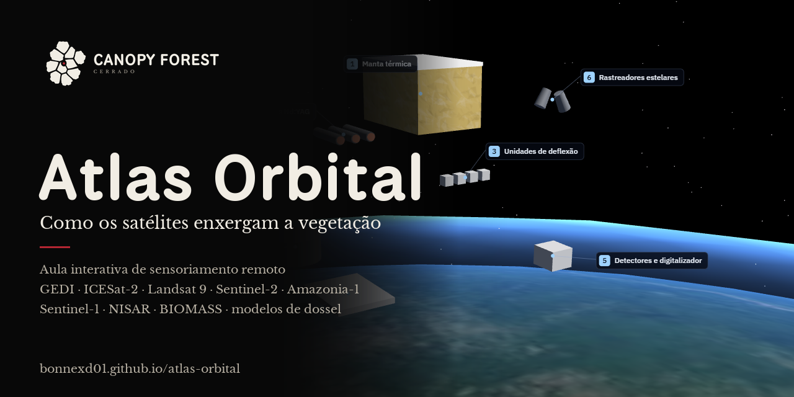
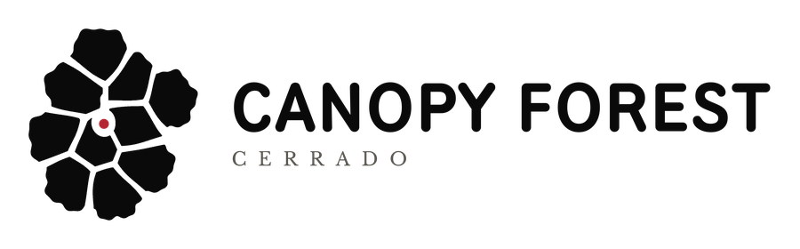

<p align="center">
  <a href="https://bonnexd01.github.io/atlas-orbital/"></a>
</p>

<p align="center">
  <a href="https://bonnexd01.github.io/atlas-orbital/"><b>Abrir a aula</b></a> ·
  <a href="https://bonnexd01.github.io/atlas-orbital/professor.html"><b>Notas do professor</b></a>
</p>

# Atlas Orbital

Aula interativa de sensoriamento remoto da vegetação, feita para a disciplina de Sensoriamento Remoto do curso de Geografia.

Uma Terra 3D com oito satélites reais em órbita: **GEDI, ICESat-2, Landsat 9, Sentinel-2, Amazonia-1, Sentinel-1, NISAR e BIOMASS**. Cada satélite se abre para mostrar as peças, um laboratório animado explica o princípio físico (lidar, contagem de fótons, imageamento multiespectral, radar) e o último passo mostra o dado que chega ao usuário. A aula termina com os modelos de altura do dossel (GEDI + imagem + IA) e um desafio.

| Capítulo | Sensor | Laboratório |
|---|---|---|
| [GEDI](https://bonnexd01.github.io/atlas-orbital/#gedi) | Lidar de forma de onda | pulso, forma de onda e RH98 em floresta, cerradão, cerrado e campo |
| [ICESat-2](https://bonnexd01.github.io/atlas-orbital/#icesat2) | Lidar de contagem de fótons | nuvem de fótons, dia × noite, classificação ATL08 |
| [Landsat 9](https://bonnexd01.github.io/atlas-orbital/#landsat9) · [Sentinel-2](https://bonnexd01.github.io/atlas-orbital/#sentinel2) · [Amazonia-1](https://bonnexd01.github.io/atlas-orbital/#amazonia1) | Óptico multiespectral | varredura pushbroom, curvas espectrais, NDVI, estação seca × chuvosa |
| [Sentinel-1](https://bonnexd01.github.io/atlas-orbital/#sentinel1) · [NISAR](https://bonnexd01.github.io/atlas-orbital/#nisar) · [BIOMASS](https://bonnexd01.github.io/atlas-orbital/#biomass) | Radar de abertura sintética | bandas X, C, S, L e P, penetração, duplo salto, saturação |
| [Modelos de dossel](https://bonnexd01.github.io/atlas-orbital/#dossel) | Fusão GEDI + imagem | rede neural, mapa de altura, medido × previsto |

## Como apresentar

| Tecla | Ação |
|---|---|
| → ou Page Down | avança (funciona com passador de slides) |
| ← ou Page Up | volta |
| M | abre os capítulos |
| arrastar / roda do mouse | gira e aproxima a cena |

Clique em um satélite na visão geral para ir ao capítulo dele.

## Usar sem internet

Baixe o repositório (**Code → Download ZIP**), descompacte e abra `index.html` no Chrome ou no Edge. As texturas e o Three.js estão na pasta; só as fontes vêm da internet.

## Estrutura

```
index.html          aula
professor.html      notas do professor
js/conteudo.js      textos, dados dos satélites e quiz (edite aqui)
js/modelos.js       satélites 3D procedurais
js/labs.js          laboratórios animados
js/app.js           cena, câmera e navegação
lib/three.min.js    Three.js r128 (licença MIT)
assets/             texturas da Terra (NASA, domínio público)
assets/marca/       identidade Canopy Forest · Cerrado
```

## Créditos

Dados dos satélites conferidos em novembro de 2026; as fontes estão nas [notas do professor](https://bonnexd01.github.io/atlas-orbital/professor.html).
Three.js © 2010–2021 three.js authors, licença MIT. Texturas da Terra: NASA Blue Marble e Black Marble (domínio público), nas versões distribuídas com o pacote three-globe.

---

<p align="center">
  <picture>
    <source media="(prefers-color-scheme: dark)" srcset="assets/marca/assinatura_clara.png">
    
  </picture>
  <br>
  <sub>Divulgação científica sobre a vegetação nativa do Cerrado</sub>
</p>
